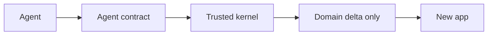

# Boilerplate robustness and agent-kernel features

## Verdict

Keep the kernel. Do not rebuild tenancy, JWT/refresh, TOTP, API keys, Flyway-per-schema, or the Nuxt admin shell. Those are production-shaped and covered by ArchUnit plus integration tests ([ArchitectureTest.java](backend/src/test/java/com/polygis/ArchitectureTest.java), `*IT` classes).

Do not tell an agent "leave auth and tenancy alone" until the trust gaps below are closed. Today the first agent task on a new app is often "repair the starter," which spends the tokens this library is meant to save.

## What is already solid

- Schema-per-tenant: validated schema names, `search_path` set on borrow and reset on release, migrate-all-tenants before JPA, `NOTIFY` plus a 60s poll ([TenancyConfig.java](backend/src/main/java/com/polygis/tenancy/TenancyConfig.java)).
- Session model: hashed refresh tokens, family rotation, reuse detection, host-only `HttpOnly` cookie; access JWT checks `typ` and issuer; RS256 JWKS.
- TOTP with replay window, hashed recovery codes, impersonation cannot change credentials.
- API keys: secret shown once, SHA-256 at rest, permissions capped to the creator.
- RBAC seed, audit log, plans (`free` / `pro` / `enterprise`), RFC 7807 for `ApiException`, request id in logs.
- Frontend flows are wired, not stubbed: login, OTP, MFA, OAuth callback, users, roles, settings, API keys, audit, tenant provisioning.

## Trust gaps (fix before the kernel is frozen)

These are the findings that make agents reopen auth, security config, or list pages.

- **Dev is the default profile.** [application.yml](backend/src/main/resources/application.yml) sets `spring.profiles.default: dev` with a published JWT secret, super-admin `ChangeMe!123`, and `dev-header-fallback: true` (anonymous `X-Tenant-ID` picks the tenant). A deploy that forgets `SPRING_PROFILES_ACTIVE` ships that profile. There is no fail-closed prod check for placeholder secrets.
- **OAuth2 skips MFA and can adopt an unverified local account.** Password login challenges TOTP; social login issues a session directly. Linking by email does not clear an existing password, so a pre-registered unverified account keeps the attacker's password after the victim signs in with Google.
- **`user:write` or `role:write` can escalate to `TENANT_ADMIN`.** Role assignment only blocks the name `SUPER_ADMIN`. API-key creation already caps permissions to the caller; role admin does not. Nothing stops deleting the last tenant admin.
- **Access tokens stay valid for 15 minutes** after logout, disable, password change, or permission removal. Only refresh tokens are revoked.
- **Refresh, OTP, and quota checks are read-then-write** with no `@Version` or row lock. Two concurrent refreshes can both succeed; user quota can be exceeded.
- **`X-Forwarded-*` is trusted from any client** (`forward-headers-strategy: framework`). Direct access to port 8080 spoofs the tenant host and the rate-limit IP. Nginx overwrites these headers; the app does not require that proxy.
- **Problem responses are incomplete.** Unmapped errors (duplicate key, bad `sort`, malformed JSON) fall through with `server.error.include-message: always`. Filter responses omit a stable `code`.
- **Frontend hides failures as empty lists.** Admin tables ignore `useFetch` error. Settings load failure leaves a saveable default form. OpenAPI types in [api.generated.ts](frontend/app/types/api.generated.ts) are stale and unused; pages import hand-written [api.ts](frontend/app/types/api.ts). Login's 401-refresh replay can resend the expired bearer. CI typechecks and builds, but does not run frontend tests or fail on spec drift.
- **Partial product holes agents will "helpfully" patch:** TOTP secret stored in plaintext; API keys survive user delete and plan downgrade; unknown plan name means unlimited users; `sso` is listed and never enforced.

## Feature list, ranked by tokens an agent would otherwise spend

Each item is something almost every generated app needs, that does not exist as a stable API today, and that should be called rather than copied.

### 1. Agent contract (highest ROI, almost no runtime code)

One [AGENTS.md](AGENTS.md) plus a Cursor rule. The agent is told the kernel packages are frozen and is given the only legal way to add a feature:

- Tenant migration in `db/migration/tenant/`, never `public/`, unless the table is platform-global.
- Controller with `@PreAuthorize`, permission seeded in the migration, menu item plus `definePageMeta({ permission })`.
- Call `$api` / `useApi`. Never send `X-Tenant-ID` on `/auth/*`, `/me`, `/platform/*`.
- Errors go through `problemOf()`. Empty and error are different states.
- DTOs come from the generated client, not a second hand-written file.
- Do not edit `tenancy`, `auth`, `config.SecurityConfig`, refresh cookies, or the tenant filters.

CI fails if `api.generated.ts` drifts from `openapi.json`. This single contract stops the agent from re-reading the kernel on every app.

### 2. Module recipe the agent fills in, not copies

A documented, minimal vertical slice (one sample resource is enough) that already uses the primitives below: Flyway file, entity, repository, service, controller, permission seed, Nuxt page, sidebar entry, one integration test extending [IntegrationTestBase.java](backend/src/test/java/com/polygis/support/IntegrationTestBase.java). New apps should add a resource in a few dozen lines of domain code.

### 3. Entity kernel

Shared mapped superclass agents extend instead of reinventing columns:

- `id`, `createdAt`, `updatedAt`, `createdBy`, `@Version`
- soft delete that actually scrubs secrets (today only `User`, and `totp_secret` survives)
- sort allowlist so `?sort=passwordHash` cannot 500
- capped page size (Spring's default max is 2000) and a `PageResponse` that already exists in `common`

### 4. Generated API client as the only contract

Fix login's OpenAPI type (controller returns `Object`, so the spec says `Record<string, never>`). Generate a typed client and delete the parallel hand-written DTO surface. Agents then add an endpoint by changing Java and regenerating, not by editing two TypeScript files and hoping CI notices.

### 5. Frontend kit: list, form, problem

Three components, used by every admin page:

- list page with loading, empty, and error (today a 500 renders "No users found")
- dialog form that maps RFC 7807 `errors` onto fields
- mutation helper that toasts `detail` and does not treat 401 as a domain error

Also fix the refresh replay so the retried request uses the new access token. Agents currently copy the broken DataTable from [users.vue](frontend/app/pages/admin/users.vue).

### 6. Feature gate that is actually enforced

`@RequiresFeature("api-keys")` (and the Nuxt equivalent) backed by [PlanService.java](backend/src/main/java/com/polygis/tenancy/PlanService.java). Unknown plan names must fail closed, not become unlimited. `sso` should either be enforced or removed. Agents stop sprinkling ad-hoc plan checks, and the UI can hide a page the plan does not include.

### 7. Idempotency-Key on unsafe POSTs

Filter plus a small store in the tenant schema. Provisioning, invites, webhooks, and payments are the calls agents otherwise wrap in homemade dedupe.

### 8. Transactional outbox, with mail as the first consumer

[MailService](backend/src/main/java/com/polygis/mail/MailService.java) sends after commit with in-process retries and then drops the message. An outbox table plus the existing [TenantJobRunner.java](backend/src/main/java/com/polygis/tenancy/TenantJobRunner.java) makes "do this after commit" a library call. Same table later drives webhooks.

### 9. Outbound webhooks

Signed payload, retries, delivery log, tenant-scoped subscriptions. Every B2B app the agent generates asks for this, and the plan comments already mention a PSP webhook that was never built.

### 10. Object storage port

`Storage` interface (local in dev, S3-compatible in prod), size and content-type limits, tenant prefix. Branding logo is only an `https://` string today. Uploads are the other feature agents rewrite on the first real app.

### 11. Notifications

In-app feed (tenant schema, unread count, mark read) plus the existing mail templates as the email channel. No push, no SMS. Enough that "tell the admin" is not a new subsystem.

### 12. Job API on top of TenantJobRunner

Register a tenant-scoped job with retry and a dead letter. The runner, advisory lock, and nightly token purge already exist. Agents need a way to add a job without copying that wiring. Document the pool-size cap so `migration-parallelism` cannot equal the Hikari pool and deadlock startup.

### 13. Observability defaults

Micrometer counters for login failure, refresh reuse, rate limit, provisioning, and mail/outbox failure. JSON logs in the prod profile. Put `requestId` inside the problem body (it is already the `X-Request-Id` header). Health indicator for tenant migration drift. Agents should not add a metrics stack per app.

### 14. Prod profile that refuses to boot unsafe

A `prod` document that is the default in Docker (compose already sets `SPRING_PROFILES_ACTIVE: prod` — the app has no such document). Startup fails if the JWT secret is missing, short, or equal to the dev placeholder, if the super-admin password is `ChangeMe!123`, or if `dev-header-fallback` is true. Trust forwarded headers only from a configured proxy CIDR. Set `server.error.include-message: never`.

### 15. i18n hooks, English only at first

`MessageSource` for API `detail` and mail subjects, locale on the user later. Agents stop hardcoding the next language into Java and Vue one string at a time. Do not add a second language in the library itself.

### 16. Security closures that belong inside the frozen kernel

Ship these inside the packages the agent is forbidden to edit, so they are not re-solved per app:

- OAuth2 must pass the same MFA challenge as password login, and must not activate an unverified account while keeping the old password.
- Role and user updates cannot grant permissions the caller does not hold. Refuse to remove the last tenant admin.
- Optimistic lock or `UPDATE ... WHERE revoked_at IS NULL` on refresh rotation.
- Optional access-token denylist or a short `authz_version` claim checked on each request after disable, password change, and role edit.
- Encrypt TOTP secrets. Revoke API keys when the user is deleted or the plan loses `api-keys`.
- Map duplicate-key to `409` and validation/sort errors to problem responses with a stable `code`.

## Explicitly out of scope

Do not add these to the library. They are product-specific, and an agent should generate them per app: billing provider integration, full-text search engine, GraphQL, mobile push, a workflow engine, multi-region, custom-domain DNS verification beyond a single column check.

## Suggested order if this becomes implementation work

1. Prod fail-closed, problem responses, OAuth/RBAC/refresh fixes (trust).
2. AGENTS.md, module recipe, OpenAPI client, CI drift check (contract).
3. Entity kernel, list/form kit, feature gate (so the recipe is short).
4. Outbox, webhooks, storage, notifications, jobs, metrics (the features agents currently generate).
